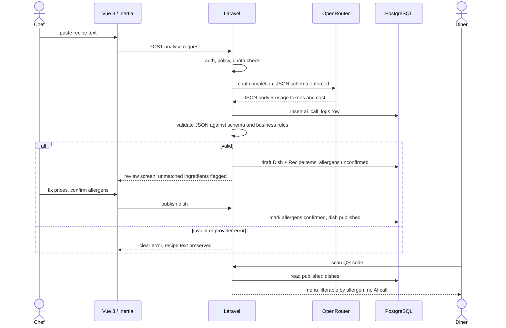
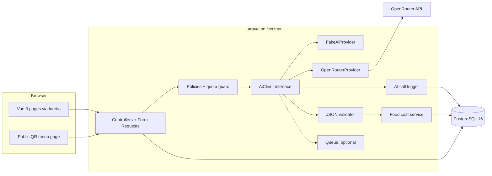
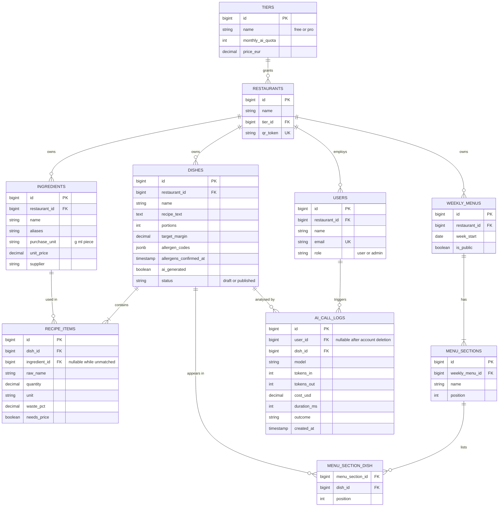

# recettIA

> Paste a recipe. Get the real food cost, the 14 EU allergens and a QR menu, with every number computed by code, not by the model.

`recettIA` is a web app for chefs, small-restaurant managers, caterers and food trucks. The chef types a recipe in plain text. A language model extracts the ingredients, quantities and allergens as strict JSON. From there, everything is ordinary application code: Laravel validates the JSON, links each ingredient to the restaurant's supplier price list, computes the food cost per portion, applies the target margin, and publishes a technical sheet and a public QR menu that diners can filter by allergen.

It is **not** a chat wrapper. There is no conversation and no free-form answer shown to the user. The model proposes, the code decides: a model response that does not pass validation is rejected, an ingredient the code cannot match to a price is flagged for manual entry and never guessed, and no dish reaches the QR menu until the chef has confirmed its allergens.

---

## Status

🚧 **Skeleton in place.** Course week S2 (10 Nov 2026), heading towards review 1 on 24 Nov 2026. The repository contains the official Laravel Vue starter kit (Laravel, Inertia, Vue 3, Fortify authentication, Pest) and a CI workflow ([`.github/workflows/tests.yml`](.github/workflows/tests.yml)). There is no recettIA domain code yet: no business entity, no migration beyond the starter kit's, no AI code. Every feature below is **Planned** unless stated otherwise.

School project 2 of the *Projet d'intégration de développement* course (5IDEV, Ifosup Wavre, 2026-2027): [course page](https://cours.tsix.be/cours/projet-dintegration-de-developpement/projet-2).

---

## Why not just ask ChatGPT?

A chef can paste a recipe into any chatbot and get a list of allergens back. What recettIA adds:

- **A strict JSON contract.** The model must return a fixed schema (ingredients, quantities, units, allergen codes). Anything else is rejected by the server, not shown to the user.
- **Real food cost, linked to your prices.** Quantities are matched to the restaurant's own supplier price list. The cost per portion, margin and selling price are computed in PHP, not estimated by the model.
- **A QR menu that never calls the AI.** Once a dish is confirmed, the public menu and its allergen filter are plain database reads. Diners can use it a million times at zero AI cost.
- **Allergens from a closed list.** Only the 14 allergens of EU Regulation 1169/2011 are accepted, and the chef must confirm them before publication.
- **Metered and capped.** Every model call is logged with tokens, cost and duration. Each account has a quota tied to its tier, enforced before the call is made.

---

## The core AI feature (O1)

One sentence: the chef enters a free-text recipe (**X**); the model returns its ingredients, raw quantities and the mandatory allergens as strict JSON (**Y**); Laravel validates the JSON, links each ingredient to the supplier price list, computes the real food cost and target margin, stores the result in `Dish` and `RecipeItem`, and serves a technical sheet and a QR menu filterable by allergen without ever calling the model again (**Z**).

| Step | Who | What |
|---|---|---|
| X | Chef | Free-text recipe, any format, French or English |
| Y | Model (via OpenRouter, called by Laravel only) | Strict JSON: ingredients, quantities, units, allergen codes |
| Z | Laravel | Validation → price matching → cost and margin → `Dish` / `RecipeItem` rows → technical sheet and QR menu (0 AI calls) |

What the model does **not** do: the supplier price catalogue, margin and break-even maths, organising the menu into sections, stock management, or rendering the client-facing menu.



### Example (Y)

Input text (X):

```text
Risotto aux crevettes pour 4 personnes : 320 g de riz arborio, 400 g de crevettes
décortiquées, 2 gousses d'ail, 60 g de beurre, 15 cl de vin blanc sec, 80 g de parmesan.
```

Expected model output (Y), before any server-side processing:

```json
{
  "schema_version": 1,
  "dish": {
    "name": "Risotto aux crevettes",
    "portions": 4
  },
  "ingredients": [
    { "name": "riz arborio", "quantity": 320, "unit": "g" },
    { "name": "crevettes décortiquées", "quantity": 400, "unit": "g" },
    { "name": "ail", "quantity": 2, "unit": "piece", "note": "gousses" },
    { "name": "beurre", "quantity": 60, "unit": "g" },
    { "name": "vin blanc sec", "quantity": 150, "unit": "ml" },
    { "name": "parmesan", "quantity": 80, "unit": "g" }
  ],
  "allergens": [
    { "code": "crustaceans", "source_ingredients": ["crevettes décortiquées"] },
    { "code": "milk", "source_ingredients": ["beurre", "parmesan"] },
    { "code": "sulphites", "source_ingredients": ["vin blanc sec"] }
  ]
}
```

The model never returns prices, costs or margins. Those fields do not exist in the schema.

---

## Features

### MVP Core — planned

**O1 · AI feature**
- [ ] Free-text recipe input with a length limit
- [ ] Server-side OpenRouter call returning strict JSON
- [ ] JSON validation (schema + business rules) before anything is stored
- [ ] Ingredient matching against the price list, unmatched ingredients flagged
- [ ] Food cost per portion, target margin, suggested selling price
- [ ] Technical sheet per dish
- [ ] Public QR menu filterable by allergen, with no AI call

**O2 · Business data**
- [ ] `Dish`, `Ingredient`, `RecipeItem`, `MenuSection`, `WeeklyMenu` with foreign keys
- [ ] Form Request validation on every write
- [ ] Demo seeders (restaurant, price list, dishes, weekly menu)

**O3 · Accounts and access**
- [x] Registration, login, logout, password reset, email verification (provided by the Laravel Vue starter kit, Fortify)
- [ ] Roles `user` and `admin`
- [ ] Policies: a user only sees their own (or their restaurant's) data
- [ ] Responsive layout usable on a phone

**O4 · Cost and quotas**
- [ ] `ai_call_logs`: date, user, model, tokens in/out, cost, duration, success/failure
- [ ] Admin dashboard: totals per day and per user
- [ ] Quota per user/group tied to the tier, checked before each call

**O5 · AI failure handling**
- [ ] Fake AI provider with scenarios (ok, timeout, down, credit exhausted, invalid JSON)
- [ ] Admin setting to force a failure scenario
- [ ] Clear message, input preserved, non-AI features still reachable

**O6 · Offer**
- [ ] Public landing page
- [ ] Two tiers (Free, Pro), quotas derived from observed costs
- [ ] Admin switches a user's tier manually (no payment)

**O7 · Legal and transparency**
- [ ] Legal notice, privacy policy, AI transparency page
- [ ] "Generated by AI" label on every model output
- [ ] Account and data deletion by the user

### Planned (supplementary, none promised)

To be chosen later. One well-integrated extra is preferred over several rushed ones. Candidates only: price history per ingredient, PDF export of technical sheets, deterministic allergen keyword cross-check, multilingual QR menu.

---

## Architecture



The browser never talks to OpenRouter. The API key lives only in the server environment. `AI_PROVIDER` selects `fake` or `openrouter`; tests and demos of failure cases use `fake`.

### Trust boundary

Model output is treated as **untrusted user input**, exactly like a form submission. It is parsed, schema-validated and checked against business rules before it touches a model or the database. It is never rendered as HTML and never executed.

### Validation pipeline

1. Decode JSON. Failure → "unusable response" (O5).
2. Validate against the versioned JSON schema (required keys, types, `schema_version`).
3. Apply the rules in [Business rules & validation](#business-rules--validation): positive quantities, allowed units, allergen codes from the closed list.
4. Normalise units (`kg` → `g`, `cl`/`l` → `ml`).
5. Match ingredients to the price list (below).
6. Store a **draft** `Dish` with `RecipeItem` rows and unconfirmed allergens, inside one transaction.

### Ingredient matching against the price list

Matching is deterministic and done in PHP/SQL: normalised name (lowercase, accents stripped) → exact match on name or alias → fuzzy candidates (e.g. PostgreSQL `pg_trgm`, proposed) offered to the chef as suggestions only. If no ingredient is confirmed, the `RecipeItem` is flagged `needs_price` and the dish shows an incomplete cost. A price is **never** invented, and the model is never asked for one.

### QR menu = zero AI calls

The public menu reads only published dishes, their confirmed allergen codes and their sections. Filtering by allergen is a query (or a client-side filter on already loaded data). There is no code path from the QR menu to `AiClient`.

### Cost metering from the `usage` field

Each OpenRouter response carries a `usage` object (prompt tokens, completion tokens and cost). The logger stores these values as returned, with the model name, duration and outcome. If a response has no cost, it is computed from token counts × the configured per-token price and flagged as computed. Failed calls are logged too.

### Food cost formulas (computed in code)

```text
gross_qty       = net_qty / (1 - waste_pct)
item_cost       = gross_qty × ingredient.unit_price
cost_per_portion = Σ item_cost / dish.portions
selling_price   = cost_per_portion / (1 - target_margin)
food_cost_ratio = cost_per_portion / selling_price
```

---

## Tech stack

| Layer | Technology |
|---|---|
| Backend | Laravel 13, PHP 8.4 |
| Authentication | Laravel Fortify (from the starter kit) |
| Bridge | Inertia.js 3 |
| Frontend | Vue 3 (Composition API), TypeScript |
| Build | Vite+ (`vp` CLI, Vite-compatible toolchain from the starter kit) |
| Styling | Tailwind CSS 4 |
| Database | PostgreSQL 16 *(proposed default)* |
| AI gateway | OpenRouter, called from Laravel only |
| Model | Model choice pending, justified in the project report |
| QR code generation | Library TBD |
| Tests | Pest 5; fake AI provider *(planned)* |
| Lint / format / types | Laravel Pint, Larastan, `vp check` (lint + format), vue-tsc |
| CI | GitHub Actions |
| Hosting | Hetzner |

Model candidates (not decided): small, fast, low-cost instruction models available on OpenRouter that support structured JSON output. The choice will be made on measured accuracy on a test set of recipes and observed cost.

---

## Planned relational schema (planned, not yet implemented)

The five business entities are `Dish`, `Ingredient`, `RecipeItem`, `MenuSection` and `WeeklyMenu`. Users, tiers, AI call logs and the `restaurants` tenant are supporting tables, not counted as business entities. `restaurants` is **proposed** as the group that scopes access (O3); without it, rows are scoped to `user_id`.



Foreign keys use `restrict` where deleting a parent would silently change a cost (an ingredient used in a recipe) and `cascade` where the child has no meaning alone (recipe items of a deleted dish).

---

## Business rules & validation

| ID | Rule |
|---|---|
| BR01 | Every business row belongs to one owner (restaurant, or user if no tenant); policies enforce it server-side on every read and write |
| BR02 | Allergens come only from the closed list of the 14 EU allergens: cereals with gluten, crustaceans, eggs, fish, peanuts, soybeans, milk, nuts, celery, mustard, sesame, sulphites, lupin, molluscs |
| BR03 | The chef must confirm AI-detected allergens before a dish can be published to the QR menu |
| BR04 | Changing a published dish's ingredients resets allergen confirmation and unpublishes it |
| BR05 | Quantities and portions are > 0 |
| BR06 | Waste percentage is ≥ 0 and < 100 |
| BR07 | An ingredient unknown to the price list is flagged for manual price entry, never guessed |
| BR08 | Margin, selling price and break-even are computed in code only, never by the model |
| BR09 | An ingredient used in a recipe cannot be deleted |
| BR10 | A model call is refused before reaching the provider when the quota is exhausted |
| BR11 | Every model output shown to the user carries a "generated by AI" label |

| JSON validation rule | Severity |
|---|---|
| Response is not valid JSON | **error** |
| Missing required key or wrong type | **error** |
| `schema_version` not supported | **error** |
| Empty `ingredients` list | **error** |
| Quantity ≤ 0 or not numeric | **error** |
| Unit not in `g`, `kg`, `ml`, `cl`, `l`, `piece` | **error** |
| Allergen code not in the closed list of 14 | **error** |
| `portions` missing | warning (chef is asked) |
| Allergen `source_ingredients` not found in `ingredients` | warning |
| Ingredient not matched to the price list | warning (`needs_price`) |
| Unknown extra keys | warning (ignored) |

Errors reject the whole response and trigger the "unusable response" path (O5). Warnings are shown on the review screen and never block saving a draft.

---

## AI failure handling (O5)

Every case is reproducible without spending credit, through the fake provider (`AI_PROVIDER=fake`) or an admin setting that forces a scenario.

| Case | How to trigger | What the user sees | What is preserved |
|---|---|---|---|
| Timeout | Fake scenario `timeout` / admin toggle | "The analysis took too long. Your recipe is saved; try again or enter the ingredients manually." | Recipe text, draft dish, quota not consumed |
| Provider down | Fake scenario `down` (HTTP 5xx / connection error) | "The AI service is unavailable right now. Everything else still works." | Recipe text, draft dish, quota not consumed |
| Credit exhausted | Fake scenario `credit` (HTTP 402) | Same message as provider down; admin sees an alert on the dashboard | Recipe text, draft dish, quota not consumed |
| Unusable response | Fake scenario `invalid_json` / `bad_schema` | "The AI answer could not be used. Try again or enter the ingredients manually." | Recipe text, draft dish, quota not consumed |
| User quota reached | Set a tier quota to 0 | "You have used all analyses for this month." with the tier info | Recipe text; no call is made |

In every case: no stack trace, the price list, dishes, menus and QR menu stay reachable, and the failed call is logged with its outcome.

---

## Cost, quotas & pricing (O4, O6)

Pre-measurement estimate: about 800–1,000 tokens per recipe analysis, which with a fast low-cost model on OpenRouter is **≈ €0.0003 per call**. This is an estimate, to be replaced by the averages observed in the cost dashboard.

| Item | Source / formula | Value |
|---|---|---|
| Average cost per analysis | `avg(cost)` of successful calls in `ai_call_logs` | TBD — filled from observed costs |
| Free tier: analyses per month | chosen so the worst-case cost stays negligible | TBD — filled from observed costs |
| Free tier: max AI cost per user per month | free quota × average cost | TBD — filled from observed costs |
| Pro tier: analyses per month | | TBD — filled from observed costs |
| Pro tier: monthly price | | TBD |
| Pro tier: AI cost at full quota | Pro quota × average cost | TBD — filled from observed costs |
| Resulting margin | (price − AI cost at full quota) / price | TBD — filled from observed costs |

The development and test budget is **€1 of OpenRouter credit**. Automated tests use the fake provider only. There is no payment integration; an admin changes a tier manually.

---

## Security, privacy & legal (O7)

- **Prompt injection.** Recipe text is passed as data inside a fixed prompt. The model has no tools, no database access and no ability to trigger actions. Its output is constrained to a JSON schema and validated server-side. The worst outcome of a malicious recipe is a rejected or wrong extraction, which the chef reviews before publishing.
- **Data sent to OpenRouter.** Only the recipe text and the fixed prompt. No name, email, user ID or restaurant data. Purpose: ingredient and allergen extraction. Recipients: OpenRouter and the model provider it routes to. Retention: according to OpenRouter's and the provider's policies.
- **Provider routing (planned).** Request option `provider: { zdr: true, data_collection: "deny" }` to restrict routing to zero-data-retention endpoints that do not train on prompts. An EU-hosted provider option will be evaluated.
- **Transfers outside the EU.** OpenRouter is a US company; transfers rely on standard contractual clauses. This will be stated in the privacy policy.
- **GDPR deletion.** A user can delete their account and all business data. AI call logs are kept for cost totals with `user_id` set to null *(proposed)*.
- **AI transparency (AI Act art. 50).** A transparency page explains what the model does and does not do; every model output is labelled "generated by AI".
- **Sensitive data.** Users are told not to enter personal or sensitive data in recipe text.
- **Secrets.** The OpenRouter key exists only in the server `.env`, never in the repository or the browser bundle.

---

## Architecture decisions

ADRs to be written in `docs/adr/`.

| ADR | Decision |
|---|---|
| 0001 | Laravel + Vue 3 + Inertia.js: one deployable app, no separate API |
| 0002 | All model calls go through Laravel; the browser never sees the key |
| 0003 | Strict, versioned JSON contract; model output is untrusted input |
| 0004 | QR menu and technical sheets never call the model |
| 0005 | PostgreSQL 16 as the database *(proposed)* |
| 0006 | Quota enforced server-side before each call, tied to the tier |
| 0007 | `AiClient` interface with a fake provider for tests and failure demos |

---

## Installation

```bash
git clone https://github.com/buhovac/recettia.git
cd recettia
composer install
npm install

cp .env.example .env
php artisan key:generate
# Set DB_PASSWORD (and DB_USERNAME if needed) in .env, then start PostgreSQL 16.
# Optional: a local PostgreSQL 16 container (any other local PostgreSQL works too)
docker compose up -d
php artisan migrate

composer run dev
```

`composer run dev` starts the Laravel server, a queue worker, the log viewer (Pail) and the Vite dev server together.

Environment variables (names only, values in your local `.env`, never committed):

```dotenv
DB_CONNECTION=pgsql
DB_HOST=127.0.0.1
DB_PORT=5432
DB_DATABASE=recettia
DB_USERNAME=recettia
DB_PASSWORD=

# AI (not wired yet: no code reads these variables)
OPENROUTER_API_KEY=
OPENROUTER_MODEL=
AI_PROVIDER=fake            # planned: fake | openrouter
AI_FAKE_SCENARIO=           # planned: ok | timeout | down | credit | invalid_json | bad_schema
AI_TIMEOUT_SECONDS=
```

## Requirements

- PHP ≥ 8.4.1
- Node.js ^22.18 or ^24.11
- Composer 2
- PostgreSQL 16 (optional local container via `compose.yaml`; any other local PostgreSQL 16 works)

## Testing

```bash
php artisan test                                    # Pest (SQLite in memory, no PostgreSQL needed)
vendor/bin/pint --test                              # PHP code style
vendor/bin/phpstan analyse --memory-limit=1G        # Larastan, level 7
npm run check                                       # frontend lint + format check (Vite+)
npm run types:check                                 # vue-tsc
npm run build
```

The current tests are the starter kit's own (authentication, email verification, profile and security settings). There are no recettIA domain tests yet. Planned: tests for policies, validation rules, the JSON validator, cost formulas and every O5 scenario through the fake provider. No test calls OpenRouter.

---

## Deployment & CI/CD

- **Git flow:** GitHub Flow. Work on `feature/<name>`, open a pull request, get a peer review, merge into `main`. `main` is production.
- **CI (GitHub Actions, [`.github/workflows/tests.yml`](.github/workflows/tests.yml)):** runs on every pull request and every push to `main`, on PHP 8.4 and Node 22, with three jobs:
  - *PHP lint (Pint) and static analysis (Larastan)*
  - *Frontend lint, format, types and build*: `npm run build`, `npm run check`, `npm run types:check`
  - *Tests (Pest)*: `php artisan test` on SQLite in memory

  No job connects to PostgreSQL and there is no deploy job yet. Dependabot checks the workflow's GitHub Actions weekly.
- **Deploy:** merging into `main` triggers a deployment to a Hetzner server. Server type, deploy tool and production URL are TBD.

---

## Project structure

```text
README.md
compose.yaml              # optional local PostgreSQL 16
.github/
├── workflows/tests.yml   # CI: Pint, Larastan, Vite+ check, vue-tsc, build, Pest
└── dependabot.yml
app/
├── Actions/Fortify/      # starter kit: user creation, password reset
├── Http/                 # starter kit: settings controllers, requests, Inertia middleware
├── Models/User.php       # starter kit; (planned) Dish, Ingredient, RecipeItem, MenuSection, WeeklyMenu
├── Providers/
├── Policies/             # (planned) owner scoping
└── Services/Ai/          # (planned) AiClient, fake and OpenRouter providers
config/
database/
├── migrations/           # starter kit only: users, cache, jobs, passkeys, two-factor
├── factories/
└── seeders/              # (planned) demo data
resources/
├── css/
├── views/app.blade.php
└── js/
    ├── pages/            # starter kit: Welcome, Dashboard, auth/*, settings/*
    ├── layouts/
    ├── components/       # starter kit components, ui/ = shadcn-vue
    ├── composables/
    ├── lib/
    └── types/
routes/                   # web.php, settings.php, console.php
tests/                    # Pest: starter kit auth and settings tests
docs/adr/                 # (planned) architecture decision records
```

---

## Roadmap

| Week | Scope | Status |
|---|---|---|
| S1 (3 Nov) | Course kickoff, idea and team | ✅ |
| S2 (10 Nov) | README ✅, scope ✅, Laravel skeleton and CI (written and passing locally, first CI run on GitHub pending) | 🔜 in progress |
| S3 (17 Nov) | Laravel skeleton ✅, CI ✅, auth and roles, schema and seeders | ⬜ |
| S4 (24 Nov) | **Review 1**: O1 end to end with fake provider, then OpenRouter | ⬜ |
| S5 (1 Dec) | Cost log, admin dashboard, quotas, O5 scenarios | ⬜ |
| S6 (8 Dec) | QR menu, weekly menus, landing page, tiers | ⬜ |
| S7 (15 Dec) | **Review 2**: legal pages, account deletion, mobile polish, deploy | ⬜ |
| 3 Jan 2027, 23:59 | Submission | ⬜ |
| 5 Jan 2027 | Oral presentation | ⬜ |

---

## License

TBD. No `LICENSE` file yet. If a copyright holder is needed: © 2026 Marko Buhovac, Anyssa Ouahib, Jean-Marie BEYA MULUMBA.

## Authors

- Marko Buhovac
- Anyssa Ouahib
- Jean-Marie BEYA MULUMBA

School project, 5IDEV, Ifosup Wavre, 2026-2027
